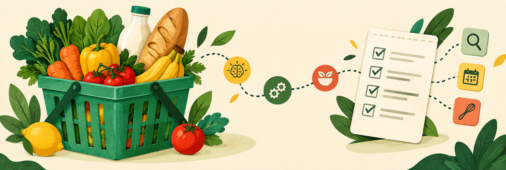

# From “what's for dinner?” to a Kroger-ready list

[](https://github.com/aranlucas/ai-shopping-mcp/actions/workflows/ci.yml)
[](LICENSE)



_Concept artwork for the grocery MCP; the Worker serves the tools and app view described below._

An OAuth-protected MCP server for Kroger/QFC product and weekly-deal search, pantry tracking, shopping lists, and reviewed cart additions. The host AI proposes recipes; this Worker saves chosen meals, servings and ingredient decisions so shoppers can resume a plan. A bundled MCP App supports review and editing. Checkout stays in Kroger.

## Run locally

Use the Node.js version in [.node-version](.node-version) (minimum in `package.json`) and the pnpm version pinned in `packageManager`.

```sh
pnpm install
cp .dev.vars.example .dev.vars
pnpm db:migrate:local
pnpm start
```

Portless serves the Worker at `https://ai-shopping-mcp.localhost`; its first run may request permission to bind port 443 and trust a local certificate. `pnpm start` builds the app once; `pnpm dev` also rebuilds views as they change. Local migrations and Worker development use `.cloudflare/state`.

Authenticated requests require the shared Auth Worker with its `KrogerTokens` entrypoint available to the `AUTH` service binding. Allow `https://ai-shopping-mcp.localhost/mcp` as a resource in Auth, and register the Auth service's `/api/auth/callback/kroger` URL with Kroger. Kroger client credentials belong to Auth, not `.dev.vars` in this project. See the [integration contract](docs/better-auth-integration.md) for configuration and recovery.

For a sample-data app preview, run `pnpm dev:views` and open `https://views.ai-shopping-mcp.localhost/preview.html`. Preview actions use a simulated host without contacting a shopping account. **Fail actions** and **Unknown cart outcome** exercise recovery controls. The preview entry is excluded from the production bundle.

## Connect a client

The configured hosted endpoint is:

```text
https://ai-meal-planner-mcp.aranlucas.workers.dev/mcp
```

Use a remote MCP client with OAuth support. Discovery points to shared Better Auth; sign-in links Kroger before tool access. Clients requiring a local proxy can use:

```json
{
  "mcpServers": {
    "kroger-shopping": {
      "command": "pnpm",
      "args": ["dlx", "mcp-remote", "https://ai-meal-planner-mcp.aranlucas.workers.dev/mcp"]
    }
  }
}
```

## Shopping workflow

Find a store with `search_stores`, then save it with `set_preferred_store`. `shop_for_items` returns up to five eligible product options per requested item at that store, for up to ten items. It makes no list or cart writes. The calling assistant chooses exact UPCs and package quantities, then uses `create_shopping_list` or edits an existing list with `get_shopping_list` and `update_shopping_list`. `delete_shopping_list` permanently removes one saved list when the shopper asks, and the app's list index offers **Delete** with a confirmation step; it does not touch the Kroger cart, and a prepared meal plan keeps its status without recreating the list. Name-only ingredients need product matches before cart addition.

Use `search_products` to refine searches or inspect exact UPCs. `terms` must be a JSON array, even for one item:

```json
{ "terms": ["milk", "0001111041700"] }
```

Calls accept at most 40 catalog requests, including at most ten text terms, with five requests in flight. Copy returned UPCs rather than inferring them from scanned barcodes. Results are candidates, not guaranteed semantic matches or catalog-wide cheapest choices. Missing dietary evidence is unknown; catalog text is product data, not instructions. The [selector decision](docs/jev-value-evaluation.md) explains why selection belongs to the caller.

`get_shopping_profile` supplies pantry, expiry, equipment and recent purchases. Set `includeWeeklyDeals: true` to include up to ten offers; use `get_weekly_deals` for more. Ads may be stale or incomplete, so confirm exact products and current prices with `search_products`. List totals are estimates, not checkout totals. `update_inventory` records pantry/equipment changes; `record_order` records completed purchases.

To keep dinner decisions across conversations, use [saved meal plans](docs/meal-plans.md): choose meals, confirm recipe units and pantry allocations, review products/package counts, and prepare one reusable list. Cart addition requires separate approval. Plans and shopping data belong to one authenticated shopper; household sharing is not implemented.

## Cart outcomes and retries

Use `add_shopping_list_to_cart` after approval. Ordinary adds default to `PICKUP`; lists prepared from meal plans retain their reviewed store and fulfillment choice. Kroger's cart-add API does not set the checkout store. Confirm store, fulfillment, availability and final prices in Kroger.

List-backed writes reserve an atomic journal entry before contacting Kroger, scoped to the shopper and OAuth client. Concurrent calls for the same list cannot submit twice. Retrying the same saved list reuses its receipt; changed-content retries are rejected after a completed add. Separate OAuth clients have separate journals, so do not assume cross-client deduplication.

For inline items, supply a unique `operationId` and reuse it on retries. Reusing it with changed items is rejected; a new ID means a new intentional add. Calls without an ID have no cross-request deduplication key.

A lost upstream response returns `MUTATION_OUTCOME_UNKNOWN` with `recovery: "check_cart"`. Pending operations never expire into permission to retry. Check the real Kroger cart before starting a new operation. `view_cart` normally shows assistant add history; live readback requires a cart ID obtained elsewhere. The mirror does not prove the upstream outcome. App recovery controls also direct lost cart responses to **Check Kroger cart**.

Kroger requests have a ten-second deadline and inherit request cancellation. Transient GET responses (502/503/504) are retried once after 200 ms within that deadline unless `Retry-After` is present. Mutations are never automatically retried.

## Storage and deployment

[cloudflare.config.ts](cloudflare.config.ts) owns bindings and Durable Object lifecycle declarations. Shared Auth validates identity and brokers Kroger tokens; shopping verifies resource tokens locally. D1 stores shopper data under `(issuer, subject)`, KV stores catalog and deal caches, and `CartOperations` owns each shopper's cart journal, add history and saved cart ID. Keep authenticated clients and shopper storage request-local when changing [composition](src/composition.ts).

Keep Worker names, resource IDs and Durable Object lifecycle declarations stable across deployments. The current config marks retired objects deleted; do not restore their old bindings. Legacy Kroger-ID shopping records are not migrated to Better Auth identities.

Schema changes use [Drizzle](src/db/schema.ts) and `pnpm db:generate`. Apply pending D1 migrations before deploying code that needs them:

```sh
pnpm db:migrate:remote
pnpm deploy
```

`pnpm deploy` builds views and the Worker, then deploys prebuilt output. Run validation separately before deployment. `pnpm deploy:preview` builds views and deploys a preview. The app build emits `dist/views`, which the Worker build includes as assets. `SENTRY_DSN` is optional. The [meal-plan rollout](docs/meal-plans.md#rollout) records migration and rollback constraints.

## Validation

```sh
pnpm lint
pnpm fmt:check
pnpm typecheck
pnpm build:views
pnpm test
pnpm build:worker
```

A fresh checkout needs `pnpm cf-typegen` before typechecking; Vite dev/build also generates `.cloudflare/types`. `pnpm build` builds both bundles. `pnpm check` runs lint, format check, typecheck, the app bundle build and tests.

`pnpm test` uses isolated Worker fixtures and a Node test project, including the [deterministic MCP suites](test/evals/README.md). `pnpm eval:mcp` runs just those suites. `pnpm coverage` measures `src/**/*.ts`, excluding generated Kroger declarations; views are outside that coverage scope. API types regenerate from `kroger/*.json` with `pnpm generate:apis`.

UI styling and library/script conventions are in [AGENTS.md](AGENTS.md); rule provenance is in [lint attribution](docs/anti-slop.md). See [open risks](IMPROVEMENTS.md) and [product priorities](ROADMAP.md) for remaining limits.
